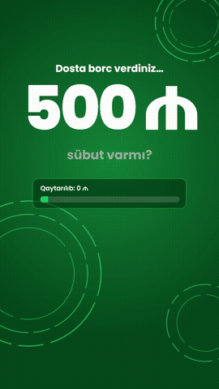
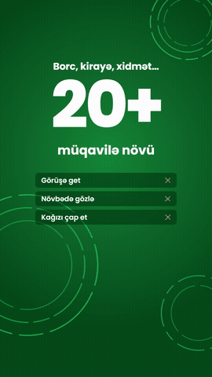
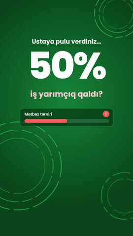

# Motion Videos as Code

     

Short vertical videos for TikTok / Reels, written as HTML + GSAP timelines and rendered deterministically to MP4.
One brand system (colours, type, sound effects, end card) is reused across the whole series.

  

## What goes into each video
- Hook in the first second, then one idea per scene
- **Kinetic typography** and data-style UI elements (counters, progress bars) animated with GSAP
- Scene-to-scene transitions designed as one continuous camera move
- **AI voice-over** with tuned pronunciation, music and sound effects mixed in
- Rendered with HyperFrames (headless Chrome + FFmpeg); some pieces in Remotion

## Series
A legal-documents service explained in 30-second videos: loan receipts, service contracts, "12 types of contracts", and more —
plus tech explainers (RAM shortage, heavy Windows, phone cleaning).

---

> **Showcase repository.** This repo presents the project — what it does, how it is built and what it looks like.
> The full source code is private. For a walkthrough or a code sample, get in touch.

**Tural Zamanlı** · Data & Automation Developer · [Portfolio](https://dicapso.github.io) · [GitHub](https://github.com/Dicapso)
